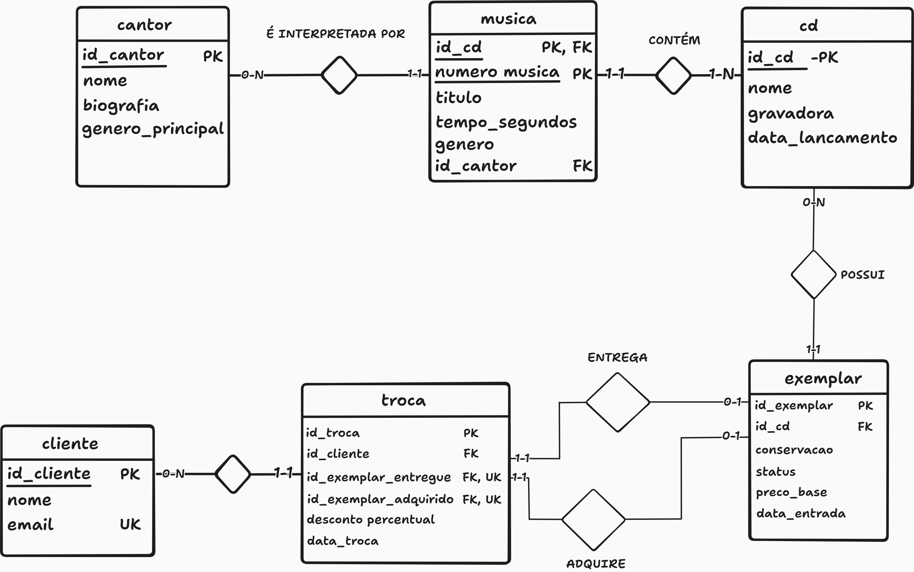

# DER — Diagrama Entidade-Relacionamento (modelo lógico)

Fonte editável: [der.tldr](diagramas/der.tldr)

## Legenda
- **PK**: chave primária (identifica cada linha da tabela)
- **FK**: chave estrangeira (aponta para a PK de outra tabela)
- **UK**: valor único (não pode se repetir)
- Os rótulos **mín-máx** ao lado de cada tabela são os mesmos do MER.

## Tabelas
| Tabela | Colunas | PK | FKs | Únicos |
|---|---|---|---|---|
| cantor | id_cantor, nome, biografia, genero_principal | id_cantor | — | — |
| cd | id_cd, nome, gravadora, data_lancamento | id_cd | — | — |
| musica | id_cd, numero_musica, titulo, tempo_segundos, genero, id_cantor | (id_cd, numero_musica) | id_cd → cd.id_cd; id_cantor → cantor.id_cantor | — |
| cliente | id_cliente, nome, email | id_cliente | — | email |
| exemplar | id_exemplar, id_cd, conservacao, status, preco_base, data_entrada | id_exemplar | id_cd → cd.id_cd | — |
| troca | id_troca, id_cliente, id_exemplar_entregue, id_exemplar_adquirido, desconto_percentual, data_troca | id_troca | id_cliente → cliente.id_cliente; id_exemplar_entregue → exemplar.id_exemplar; id_exemplar_adquirido → exemplar.id_exemplar | id_exemplar_entregue; id_exemplar_adquirido |

## Do MER para o DER
Cada entidade do MER virou uma tabela e cada atributo virou uma coluna, com os nomes do contrato do projeto. Foram aplicadas as regras abaixo.

| Relacionamento do MER | Onde ficou a FK | Justificativa |
|---|---|---|
| CD contém MÚSICA | musica.id_cd | Cada música pertence a um único CD (RN02). A FK também compõe a PK da tabela. |
| MÚSICA é interpretada por CANTOR | musica.id_cantor | Cada música tem um intérprete principal (RN03), e um cantor pode ter várias músicas. |
| CD possui EXEMPLAR | exemplar.id_cd | Todo exemplar pertence a um CD (RN04), e um CD pode ter vários exemplares (RN01). |
| CLIENTE realiza TROCA | troca.id_cliente | Toda troca tem um cliente (RN06), e um cliente pode ter várias trocas (RN05). |
| TROCA entrega EXEMPLAR | troca.id_exemplar_entregue | [Escreva: relação 1:1; coloquei a FK em troca porque ela participa com mínimo 1 e a coluna nunca fica vazia. É UNIQUE porque o mesmo exemplar não repete o papel de entregue (RN06).] |
| TROCA adquire EXEMPLAR | troca.id_exemplar_adquirido | [Escreva: mesma lógica da anterior, para o papel de adquirido (RN06).] |

### Chave primária composta de musica
[Escreva: a música é identificada pelo par (id_cd, numero_musica) porque a numeração das faixas reinicia em cada CD (RN02). Assim, a faixa 1 do CD 10 e a faixa 1 do CD 11 são músicas diferentes. A coluna id_cd é ao mesmo tempo PK e FK.]

### Dois relacionamentos entre troca e exemplar
[Escreva: uma troca envolve dois exemplares distintos, por isso troca tem duas FKs para a mesma tabela exemplar, uma por papel. Cada uma é UNIQUE, e as duas devem apontar para exemplares diferentes (RN06). O mesmo exemplar pode ser adquirido em uma troca e entregue em outra.]

## Diferenças em relação ao MER
- No MER havia entidades e atributos do negócio; no DER há **tabelas e colunas**, com nomes padronizados.
- Surgiram as **chaves**: PK em todas as tabelas, PK composta em musica e FKs nas tabelas do lado "muitos".
- Os relacionamentos deixaram de ser losangos e passaram a ser **colunas FK**.
- O atributo derivado `valor_final` continua fora do modelo: será calculado nas consultas (RN08).

## Restrições previstas para o DDL
Algumas regras não aparecem no diagrama e serão implementadas no DDL (Issue 05):
- `cliente.email` único (RN05);
- `troca.id_exemplar_entregue` e `troca.id_exemplar_adquirido` únicos, e diferentes entre si (RN06);
- valores permitidos para conservação, status e desconto (RN04 e RN07);
- preço e duração positivos.