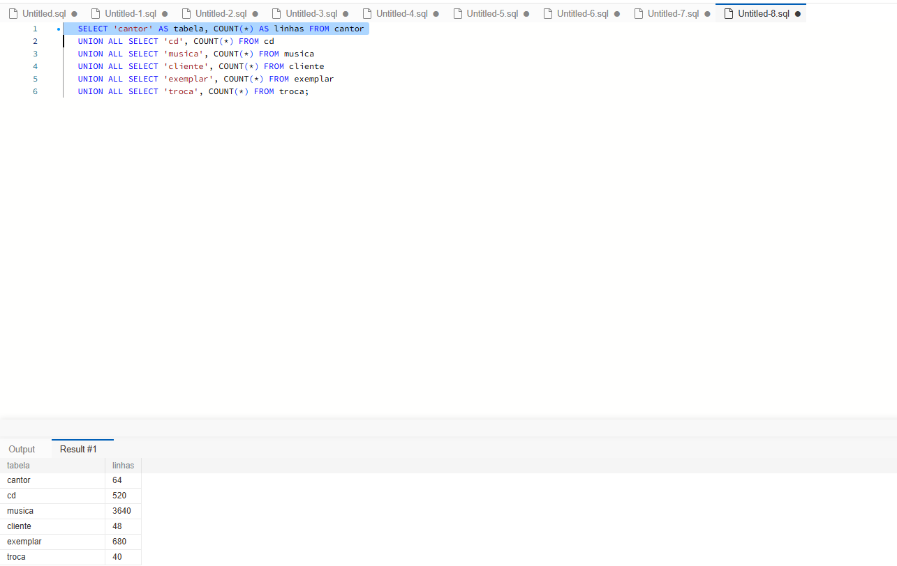
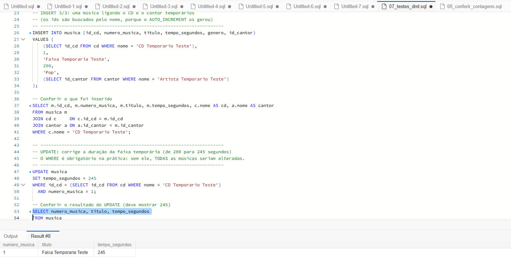
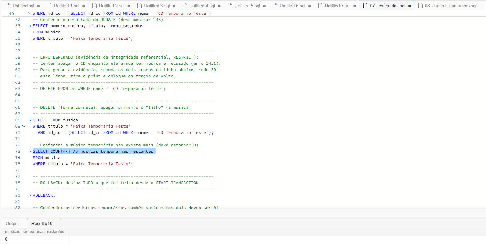
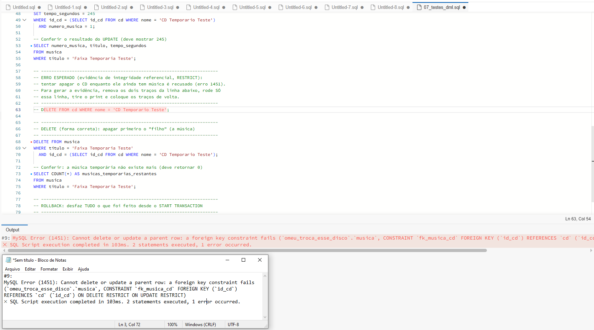
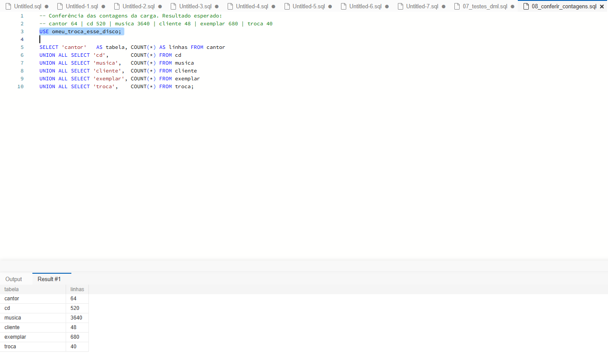

# Carga de dados e testes de DML

## Carga da massa de dados
Ordem de execução (uma vez, após o DDL): `01_inserir_cantores.sql` → `02_inserir_cds.sql` → `03_inserir_musicas.sql` → `04_inserir_clientes.sql` → `05_inserir_exemplares.sql` → `06_inserir_trocas.sql`.

Como o pacote de dados do professor não foi recebido, a massa foi **gerada com apoio de IA**, com dados 100% fictícios e as mesmas quantidades do enunciado.

Contagens obtidas com `08_conferir_contagens.sql`:

| Tabela | Linhas |
|---|---|
| cantor | 64 |
| cd | 520 |
| musica | 3.640 |
| cliente | 48 |
| exemplar | 680 |
| troca | 40 |

## Testes de DML (`07_testes_dml.sql`)
Os testes foram executados dentro de uma transação (`START TRANSACTION` ... `ROLLBACK`) sobre registros temporários, sem alterar a massa original.

- **3 INSERTs:** um cantor, um CD e uma música que liga os dois. Como os IDs são gerados automaticamente (`AUTO_INCREMENT`), a conferência é feita pelos nomes e pelos totais das tabelas:

| Tabela | Registro temporário | Total após o INSERT |
|---|---|---|
| cantor | Artista Temporario Teste | 65 (64 + 1) |
| cd | CD Temporario Teste | 521 (520 + 1) |
| musica | Faixa Temporaria Teste | 3.641 (3.640 + 1) |

- **1 UPDATE:** `tempo_segundos` da faixa temporária alterado de 200 para 245.

- **1 DELETE:** a faixa temporária "Faixa Temporaria Teste" foi apagada e a conferência retornou 0 registros.

## Erro de chave estrangeira e correção
Ao tentar apagar o CD temporário com a música ainda cadastrada, o MySQL retornou o **erro 1451**: a música ainda aponta para o CD pela constraint `fk_musica_cd`, que está definida com `ON DELETE RESTRICT`. Assim, o banco protege o CD enquanto ele tiver registros dependentes ("filhos"). A correção é apagar primeiro o filho (a música) e só depois o CD.

## Verificação final
Após o `ROLLBACK`, as contagens voltaram aos valores originais da carga e os registros temporários deixaram de existir.

