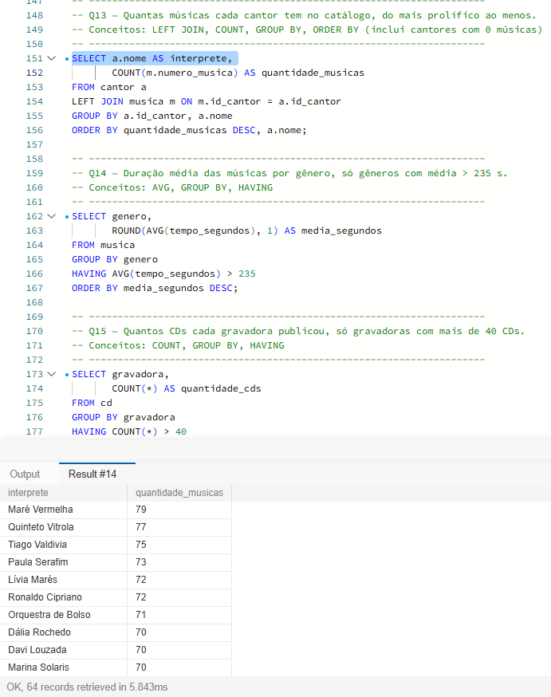
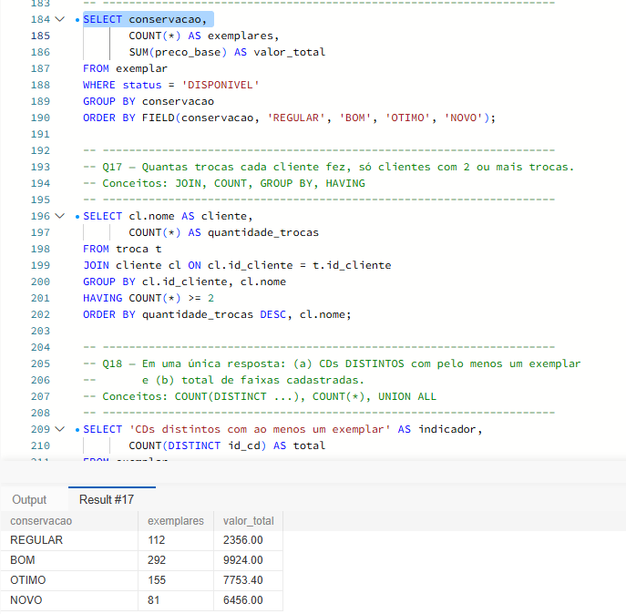
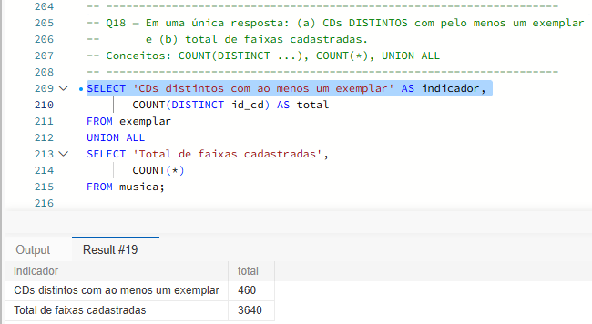
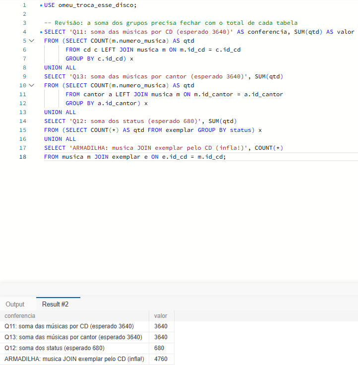

# Evidências: agrupamentos e relacionamentos (Q11–Q18)

Consultas em `database/dql/consultas.sql`, executadas no MySQL sobre a massa de dados carregada.

## Q13: músicas por cantor

A consulta responde quantas faixas cada intérprete tem no catálogo. No topo está **Maré Vermelha, com 79 músicas**, seguido de **Quinteto Vitrola** (77) e **Tiago Valdivia** (75). O `LEFT JOIN` parte de `cantor`, e não de `musica`, justamente para que **nenhum artista suma da listagem**: quem ainda não tem faixa nenhuma aparece com 0. Um `JOIN` interno esconderia esses casos, porque descartaria as linhas sem par. Os quatro intérpretes com 0 músicas são **Estação Neon, Os Girassóis de Aço, Banda Café Frio e Dora Esmeralda**. Isso não é inconsistência: pela RN03, um artista pode existir na base sem nenhuma faixa cadastrada, porque a cardinalidade do lado do cantor é 0..N. O `COUNT(m.numero_musica)` conta só valores não nulos, então as faixas ausentes viram 0 de verdade; se fosse `COUNT(*)`, cada cantor sem música contaria 1, por causa da linha nula que o `LEFT JOIN` produz. A soma de todos os grupos fecha em **3.640**, o total de `musica` (60 intérpretes com faixas + 4 sem faixas = os 64 cadastrados).

## Q16: valor do estoque disponível por conservação

Só entram no cálculo os **640 exemplares `DISPONIVEL`**, porque os 40 `TROCADO` são descartados antes; juntos, eles somam **R$ 26.489,40** de preço-base. **BOM concentra a maior parte dos dois lados**: é a conservação com mais exemplares (292) e também com o maior valor total (R$ 9.924,00). Isso acontece mesmo porque OTIMO e NOVO valem mais por unidade (cerca de R$ 50 e R$ 80, contra cerca de R$ 34 do BOM): o BOM vence pelo volume, não pelo preço. REGULAR fica com o menor valor unitário, cerca de R$ 21, e 112 exemplares.

O `WHERE` vem antes do `GROUP BY` porque ele **reduz a massa de dados antes de agrupar**: os 680 exemplares são filtrados até os 640 `DISPONIVEL` e só então somados por `conservacao`. Se a condição fosse `HAVING status = 'DISPONIVEL'`, o MySQL primeiro criaria os grupos e somaria tudo, e depois não conseguiria aplicar o filtro, já que `status` não é coluna de agregação. Em resumo, `WHERE` filtra **linhas**, antes do agrupamento, e `HAVING` filtra **grupos**, depois dele.

## Q18: CDs distintos x faixas

A resposta traz dois números em uma lista só. O primeiro, **460**, é a contagem de CDs diferentes que aparecem em `exemplar` (`COUNT(DISTINCT id_cd)`). O segundo, **3.640**, é o total de linhas de `musica` (`COUNT(*)`). A diferença entre os comandos explica a diferença entre os números: `COUNT(DISTINCT id_cd)` **elimina repetições**, contando cada CD uma única vez mesmo com vários exemplares; já `COUNT(*)` conta **linhas**, sem tirar duplicata. Como a base tem 520 CDs e 60 deles não têm nenhum exemplar, esses 60 não aparecem em `exemplar` e ficam fora dos 460. Pela RN01 isso é esperada: um título pode existir sem estoque disponível, então ter CD sem exemplar é regra de negócio, não falha. O `UNION ALL` é o que empilha as duas respostas em uma única tabela, com a coluna `indicador` servindo de rótulo para identificar cada linha.

## Revisão de contagens duplicadas

O teste é simples: somar as contagens dos grupos tem que bater com o total da tabela. Na **Q11**, somar `quantidade_musicas` de todos os CDs dá **3.640**, igual ao total de `musica`. Na **Q12**, somar `quantidade` por status dá **680**, igual ao total de `exemplar`. Na **Q13**, somar `quantidade_musicas` de todos os cantores dá **3.640** de novo. Isso mostra que os `LEFT JOIN` das Q11 e Q13 não duplicam linhas: cada música tem exatamente um CD e exatamente um intérprete, então entra na soma uma única vez.

Juntar `musica` com `exemplar` pelo CD é o contraexemplo. Como cada CD tem 7 faixas, cada um dos 680 exemplares puxaria as 7 faixas do seu álbum, e em vez de 3.640 linhas viriam **4.760** (7 × 680). A soma dos grupos passaria a exceder o total real, inflando o resultado sem que a massa de dados tivesse crescido. Por isso a escolha da tabela de partida e a chave de junção importam tanto quanto a consulta em si.
