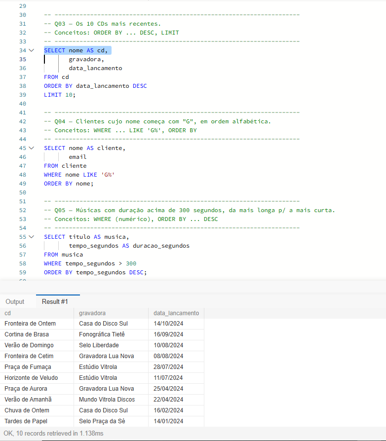
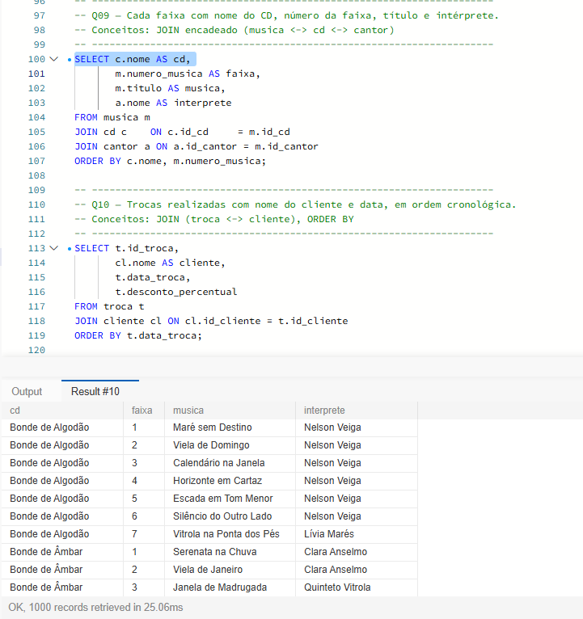
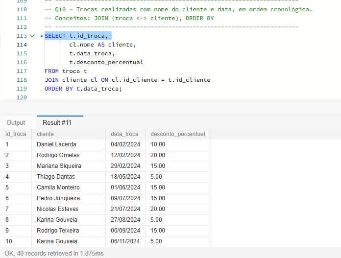

# Evidências — consultas introdutórias (Q01–Q10)

Todas as consultas estão em `database/dql/consultas.sql` e foram executadas no MySQL sobre a massa de dados carregada.

## Q03 — 10 CDs mais recentes

A consulta retorna os 10 CDs com data de lançamento mais alta, mostrando nome, gravadora e data. O `ORDER BY data_lancamento DESC` ordena as datas **do maior para o menor** (o `DESC` é o que traz os mais recentes primeiro; sem ele, viriam os mais antigos), e o `LIMIT 10` corta a lista, deixando só as 10 primeiras linhas. No resultado, o CD mais recente é **"Fronteira de Ontem"** (Casa do Disco Sul), lançado em **15/10/2024**; como não há CDs de 2025 ou 2026 na base, toda a lista fica concentrada nos anos de 2024.

## Q09 — faixa, CD e intérprete

A consulta liga **três tabelas**: `musica` (as faixas), `cd` (o nome do álbum) e `cantor` (o intérprete). As junções são feitas pelas chaves estrangeiras: `musica.id_cd = cd.id_cd` (cada música pertence a um CD) e `musica.id_cantor = cantor.id_cantor` (cada música tem um intérprete principal). O resultado tem **3.640 linhas — uma para cada música** — porque o `JOIN` encontra exatamente um CD e um cantor para cada faixa, mantendo a mesma quantidade de linhas da tabela `musica` (520 CDs × 7 faixas = 3.640). Cada linha mostra, então, de que CD a faixa faz parte, o número da faixa, o título e quem a interpreta.

## Q10 — trocas com o nome do cliente

A consulta liga `troca` com `cliente` (pela coluna `troca.id_cliente = cliente.id_cliente`) e ordena por `data_troca`, ou seja, em ordem cronológica. Cada coluna significa:

- **`id_troca`**: código identificador da troca;
- **`cliente`**: nome de quem fez a troca;
- **`data_troca`**: quando a troca aconteceu;
- **`desconto_percentual`**: o percentual de desconto aplicado naquela troca.

O desconto percentual está ligado à **conservação do CD entregue**: 5% = REGULAR, 10% = BOM, 15% = OTIMO e 20% = NOVO. Como há 40 trocas na base, o resultado traz 40 linhas.

> **Observação:** o `desconto_percentual` é gravado na própria `troca`, mas o MySQL **não obriga** esse número a corresponder à conservação do CD entregue — essa coerência é a RN07, verificada por auditoria (`database/dql/validacoes.sql`) e não imposta por restrição. Por isso o percentual *indica* a conservação, mas o banco não a garante.