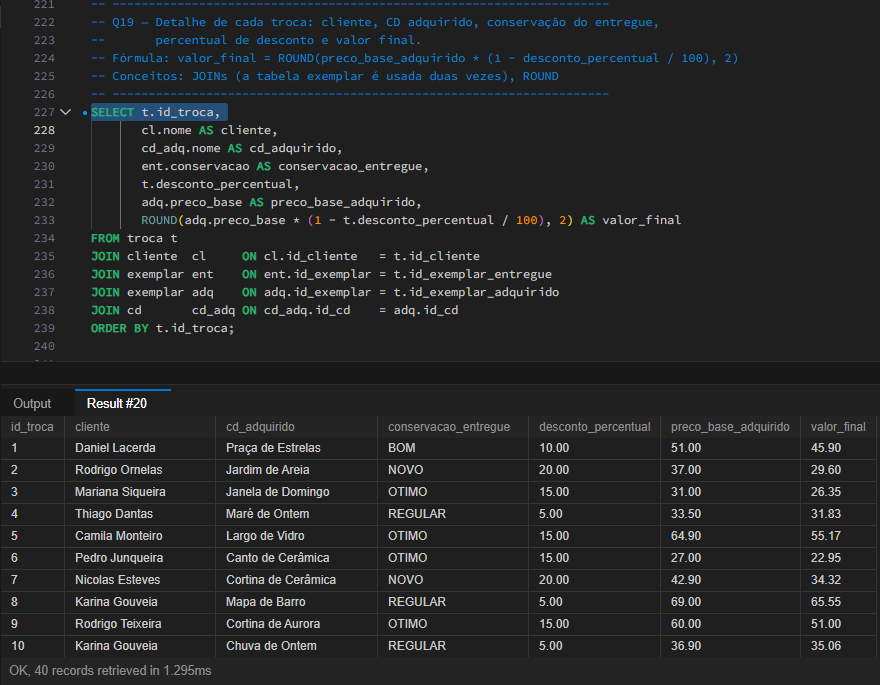
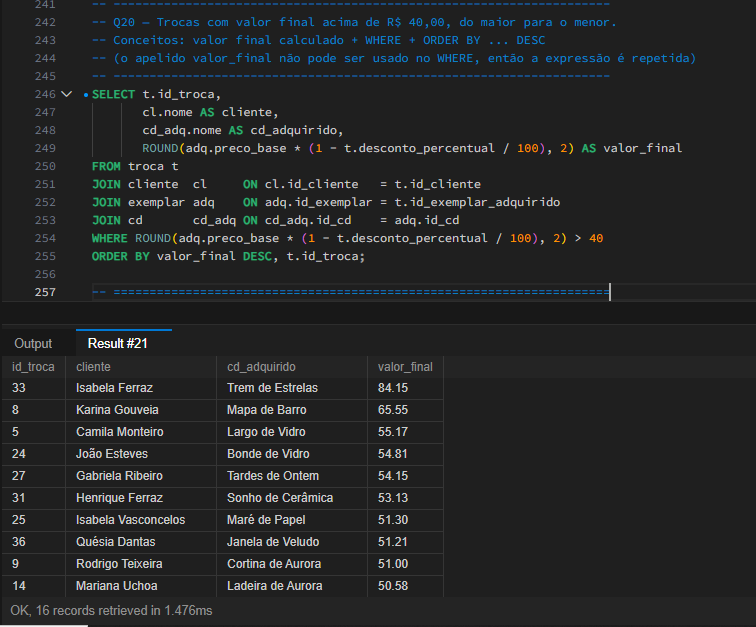
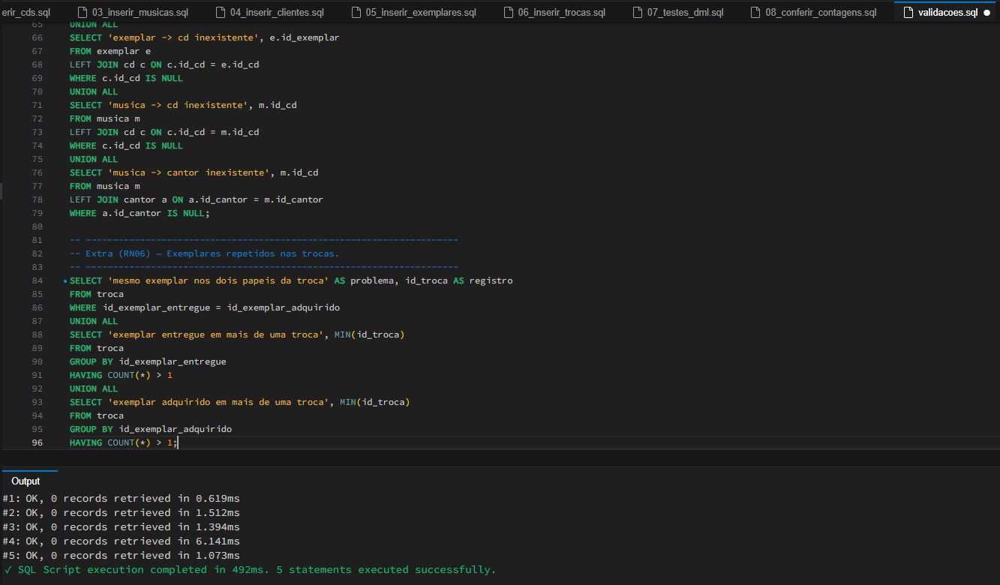
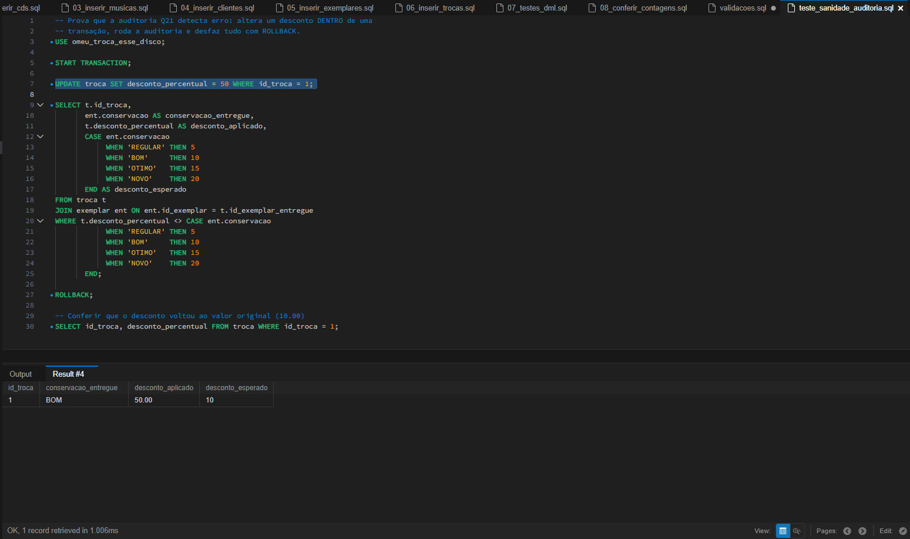

# Trocas e descontos — conferência dos cálculos financeiros

As consultas desta etapa foram escritas com apoio de IA. Eu executei cada uma no MySQL e conferi os resultados, inclusive com cálculos feitos à mão.

## Regra aplicada
O desconto depende da conservação do exemplar **entregue** pelo cliente e incide sobre o preço-base do exemplar **adquirido** (RN07 e RN08). Ele não é cumulativo e o CD entregue não gera crédito em dinheiro.

| Conservação do entregue | Desconto |
|---|---|
| REGULAR | 5% |
| BOM | 10% |
| OTIMO | 15% |
| NOVO | 20% |

`valor_final = ROUND(preco_base_adquirido * (1 - desconto_percentual / 100), 2)`

O valor final não é uma coluna da tabela `troca`: ele é calculado na consulta, a partir do preço-base e do desconto.

## Como a Q19 foi construída
A tabela `troca` guarda dois exemplares (entregue e adquirido). Por isso a tabela `exemplar` entra duas vezes no `JOIN`, com os apelidos `ent` (entregue) e `adq` (adquirido). O `cliente` é ligado por `id_cliente`, e o nome do CD adquirido vem de `cd`, ligado ao exemplar adquirido. A consulta retorna 40 linhas, uma por troca, com o valor final em duas casas decimais.

## Conferência manual (uma troca de cada conservação)
Calculei à mão o valor final de quatro trocas e comparei com o resultado do SQL:

| Troca | Cliente | CD adquirido | Conservação do entregue | Preço-base do adquirido | Cálculo manual | Valor manual | Valor no SQL |
|---|---|---|---|---|---|---|---|
| 1 | Daniel Lacerda | Praça de Estrelas | BOM (10%) | R$ 51,00 | 51,00 × 0,90 | R$ 45,90 | R$ 45,90 |
| 2 | Rodrigo Ornelas | Jardim de Areia | NOVO (20%) | R$ 37,00 | 37,00 × 0,80 | R$ 29,60 | R$ 29,60 |
| 3 | Mariana Siqueira | Janela de Domingo | OTIMO (15%) | R$ 31,00 | 31,00 × 0,85 | R$ 26,35 | R$ 26,35 |
| 4 | Thiago Dantas | Maré de Ontem | REGULAR (5%) | R$ 33,50 | 33,50 × 0,95 = 31,825 | R$ 31,83 | R$ 31,83 |

Os quatro valores conferem. Na troca 4 o cálculo exato dá R$ 31,825, e o `ROUND(..., 2)` arredonda para R$ 31,83, o mesmo valor que obtive à mão.

## Q20 — trocas com valor final acima de R$ 40,00
A Q20 usa o mesmo cálculo da Q19 e filtra os valores acima de R$ 40,00. Como o MySQL não permite usar o apelido `valor_final` no `WHERE`, repeti a expressão do cálculo no filtro. Foram retornadas 16 das 40 trocas. A de maior valor é a troca 33, de Isabela Ferraz, que levou *Trem de Estrelas* por R$ 84,15, seguida da troca 8 (Karina Gouveia, *Mapa de Barro*, R$ 65,55) e da troca 5 (Camila Monteiro, *Largo de Vidro*, R$ 55,17).

## Auditorias (`database/dql/validacoes.sql`)
O `CHECK` do MySQL só valida os valores da própria linha, por isso a coerência do desconto (RN07) e do status (RN09) não pode ser bloqueada na inserção. Ela é verificada por consultas de auditoria, que não alteram a base e devem retornar zero linhas:

| Auditoria | O que verifica | Resultado |
|---|---|---|
| Q21 | Desconto aplicado diferente do esperado para a conservação do exemplar entregue | 0 linhas |
| Q22 | Status incoerente: `TROCADO` que nunca foi adquirido, ou `DISPONIVEL` que foi adquirido | 0 linhas |
| Q23 | Referências inválidas (troca, exemplar e música apontando para registros inexistentes) | 0 linhas |
| Extra (RN06) | Mesmo exemplar nos dois papéis da troca, ou repetido no mesmo papel em trocas diferentes | 0 linhas |

Na Q22 considerei incoerente apenas o `DISPONIVEL` que foi **adquirido**. O exemplar apenas **entregue** continua `DISPONIVEL`, porque entra no estoque da loja (RN09), então ele participar de uma troca não é um problema.

## Teste de sanidade da auditoria
Uma auditoria que retorna zero linhas também poderia estar errada. Para provar que ela detecta problemas, alterei o desconto da troca 1 para 50% dentro de uma transação e rodei a Q21. Ela listou a troca 1 (conservação BOM, desconto aplicado 50,00, esperado 10). Em seguida executei `ROLLBACK` e o desconto voltou a 10,00, então a base original não foi alterada. O script está em `database/dql/teste_sanidade_auditoria.sql`.

