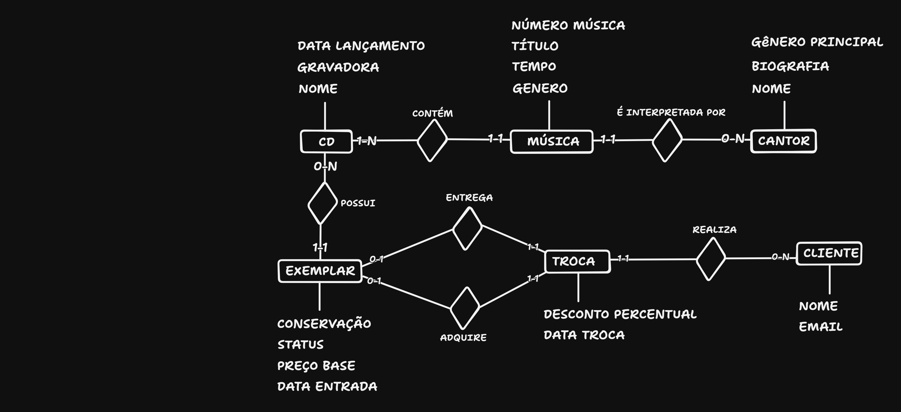

# MER — Modelo Entidade-Relacionamento

Fonte editável: [mer.tldraw](diagramas/mer.tldr)

## Como ler o diagrama
O diagrama usa a notação de Chen: retângulos são **entidades**, losangos são **relacionamentos** e a lista abaixo (ou acima) de cada entidade traz seus **atributos**.

Ao lado de cada entidade aparece a participação no formato **mín-máx**, que diz quantas vezes **aquela entidade** participa do relacionamento:
- mínimo **0** = participação opcional (pode não haver nenhuma ocorrência)
- mínimo **1** = participação obrigatória
- máximo **1** = no máximo uma ocorrência; máximo **N** = várias

Exemplo: em "CD contém MÚSICA", o rótulo **1-N** ao lado do CD significa que um CD contém de 1 a N músicas.

## Entidades e atributos
| Entidade | Atributos |
|---|---|
| CANTOR | nome, biografia, gênero principal |
| CD | nome, gravadora, data de lançamento |
| MÚSICA | número da música, título, tempo (segundos), gênero |
| CLIENTE | nome, e-mail |
| EXEMPLAR | conservação, status, preço-base, data de entrada |
| TROCA | desconto percentual, data da troca |

O **valor final** da troca não é um atributo: é **derivado** (RN08), calculado a partir do preço-base do exemplar adquirido e do desconto. Por isso não é armazenado e será calculado nas consultas.

## Relacionamentos e cardinalidades
| Relacionamento | Participação | Tipo | Justificativa |
|---|---|---|---|
| CD **contém** MÚSICA | CD 1-N / MÚSICA 1-1 | 1:N | Cada música pertence a exatamente um CD (RN02); considerei que todo CD tem ao menos uma faixa. |
| MÚSICA **é interpretada por** CANTOR | MÚSICA 1-1 / CANTOR 0-N | N:1 | Toda música tem exatamente um intérprete principal e um cantor pode ter zero ou muitas músicas (RN03). |
| CD **possui** EXEMPLAR | CD 0-N / EXEMPLAR 1-1 | 1:N | Um CD pode existir sem exemplares (RN01), mas todo exemplar pertence a um CD (RN04). |
| CLIENTE **realiza** TROCA | CLIENTE 0-N / TROCA 1-1 | 1:N | O cliente pode ter nenhuma ou várias trocas (RN05); toda troca tem um cliente (RN06). |
| TROCA **entrega** EXEMPLAR | TROCA 1-1 / EXEMPLAR 0-1 | 1:1 | Toda troca tem exatamente um exemplar entregue e o mesmo exemplar não repete esse papel em trocas diferentes (RN06). |
| TROCA **adquire** EXEMPLAR | TROCA 1-1 / EXEMPLAR 0-1 | 1:1 | Toda troca tem exatamente um exemplar adquirido, e o mesmo exemplar não repete esse papel (RN06). |

## Decisões de modelagem
- **CD x EXEMPLAR:** CD é o título do álbum (informação que não muda); EXEMPLAR é cada unidade física, com seu estado de conservação, preço e status. Separar os dois evita repetir os dados do álbum em cada unidade e permite um CD sem estoque.
- **Dois papéis de EXEMPLAR na TROCA:** Uma troca envolve dois exemplares diferentes, o que o cliente entrega e o que ele leva. Por isso há dois relacionamentos separados (ENTREGA e ADQUIRE) entre TROCA e EXEMPLAR. O mesmo exemplar pode ser adquirido em uma troca e entregue em outra, mas nunca os dois papéis na mesma.
- **MÚSICA como entidade fraca:** A faixa "3" não identifica nada sozinha; ela só faz sentido junto com o CD. Por isso a identificação será o par (CD, número da música), e no DER isso vira uma chave primária composta.
- **Regras que o MER não mostra:** os descontos por conservação (RN07), a fórmula do valor final (RN08), itens adquiridos em troca tem status trocados e recebidos pela loja integram o estoque (RN09) e a exigência de que os dois exemplares da troca sejam distintos (RN06) não aparecem no diagrama. Elas serão tratadas no DDL (restrições) e nas consultas.
- **Participação mínima do CD em "contém":** adotei que todo CD tem ao menos uma música (1-N). É uma decisão de modelagem que o banco não impõe, porque o SQL não obriga uma linha de `cd` a ter linhas em `musica`.